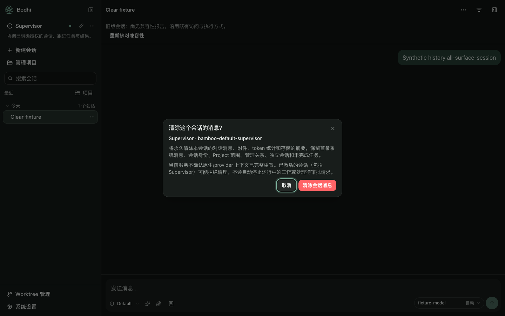
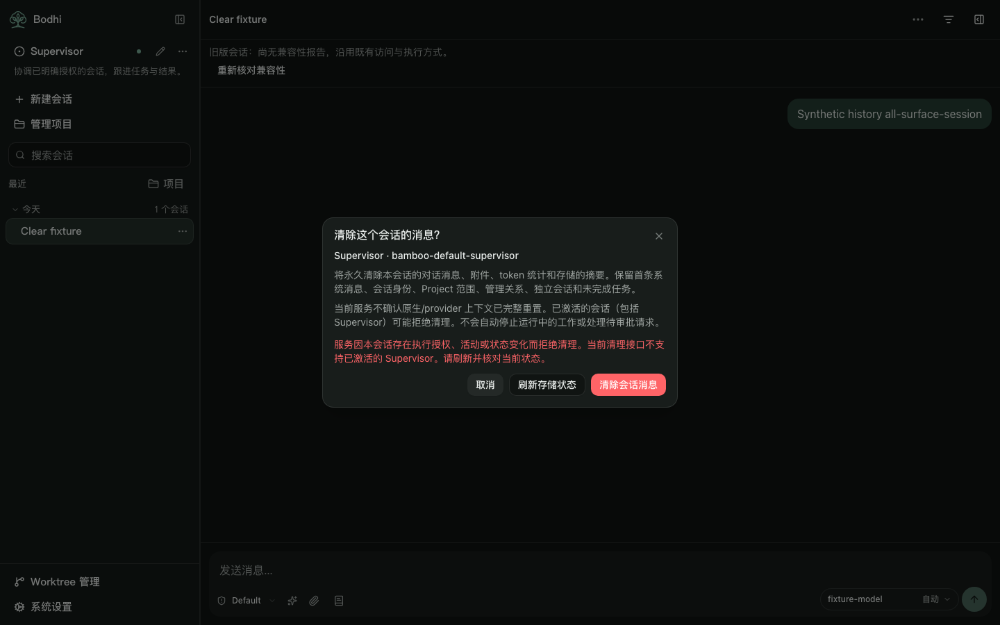
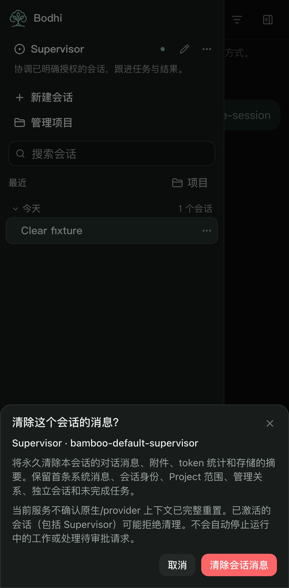
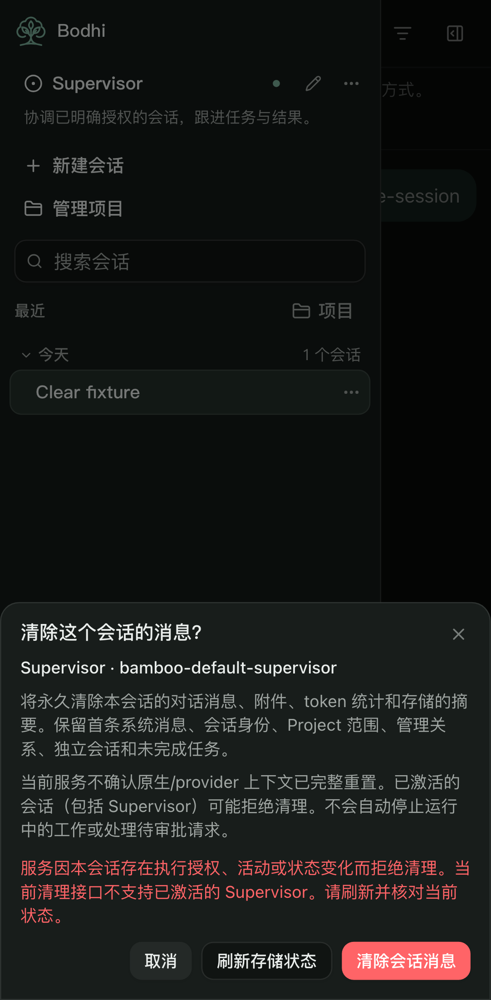

# Conversation clear — synthetic acceptance

The ordinary sidebar, Supervisor sidebar, conversation header and simple-mode
System settings open the same confirmation. The selected session identity is
fixed for the lifetime of that confirmation. Cancelling sends no request.
Bulk deletion and development storage reset remain advanced controls.

## Frozen C1 boundary

Consumer of [Bamboo #2150](https://github.com/bigduu/Bamboo-agent/pull/2150),
source `f19d80eee453897e7eba1f5ffcffcc8229520a98`, tree
`b12ef59cf0ebcc87077c677fabf61485a843909b`; tracked by
[Bamboo #2147](https://github.com/bigduu/Bamboo-agent/issues/2147).
The producer's `docs/fixtures/session-history-clear-outcomes.json` was compared
with the frontend's synthetic HTTP fixtures. No backend code is included here.

- One body-free `POST /api/v1/sessions/{id}/clear`; require exact
  `{success:true,session_id}` before checking the stored result.
- Verify matching detail/history identities, idle state, no reported pending
  question, empty token usage (omitted by C1 serde, or explicit `null`), matching message count and only zero or one
  retained System message. Readback is required; best-effort history loading
  cannot produce success.
- Active work, pending questions/approvals and unverified preflight state send
  no clear request. Authority/version refusals remain explicit. A transport,
  storage or malformed-receipt failure is uncertain and never retried
  automatically. Readback failures retain existing local messages.
- Uncertain results remain locked across dialog/entry reopen in the current
  page lifetime. Explicit verification is read-only. A matching cleared
  snapshot after an unknown request does not retrospectively confirm that
  request. A full page reload does not retain this memory-only journal.
- A `session_cleared` feed event always invalidates older in-flight reads locally,
  including held refreshes while busy; a read-only replacement is deferred until
  busy work settles. Replacement intent survives superseding monotonic reads and
  failed reads until a new history/detail snapshot applies. Live and persisted
  token views are refreshed together; old prefix-cache statistics cannot carry
  into the new conversation. It covers loaded active/inactive sessions. C1 exposes
  no conversation revision; this is **not** a complete cross-client stale-read
  guarantee, a durable operation journal or a transaction protocol.

This preserves session identity, Project scope, management links, independent
sessions and unfinished tasks in the frontend. C1 does not support clearing an
activated Supervisor. Compression events, native/provider state and prompt
snapshots are not explicitly reset by C1. The UI does not promise a complete
model-context reset. The future transaction/CAS protocol is a separate task.

## Validation and screenshots

All images and browser HTTP responses use synthetic fixture data. No real
history, account, profile, provider, Rust runtime or frozen release was touched.

- Complete frontend unit suite: 196 files / 4,155 tests passed.
- New clear browser suite: 33 cases across desktop, tablet and phone, including
  nine held-refresh, superseding-read and live-token-cache regression cases.
- Existing Supervisor/settings navigation regression: 24 cases passed.
- TypeScript, lint, i18n, architecture, production build, artifact and package
  checks pass without relaxing bundle budgets.

The browser suites run with automatic retries disabled. The local task retains
initial sandbox launch failures and the first fixture-selector/pending-state
failures separately. They are not counted as successful acceptance. Backend
Cargo/runtime and a real HTTP C1 round trip remain unrun.

Independent source review found and corrected four C1 mismatches: empty token
usage is omitted by the producer's serde, and feed-clear events must fence old
reads even while an action is busy. Subsequent monotonic reads must inherit a
pending replacement, and authoritative reconciliation must reset live token
and prefix-cache statistics. The synthetic fixtures now use the actual
omitted-field shape; null remains accepted for compatibility. Held-read tests
cover the event fence and deferred GET-only reconciliation.

