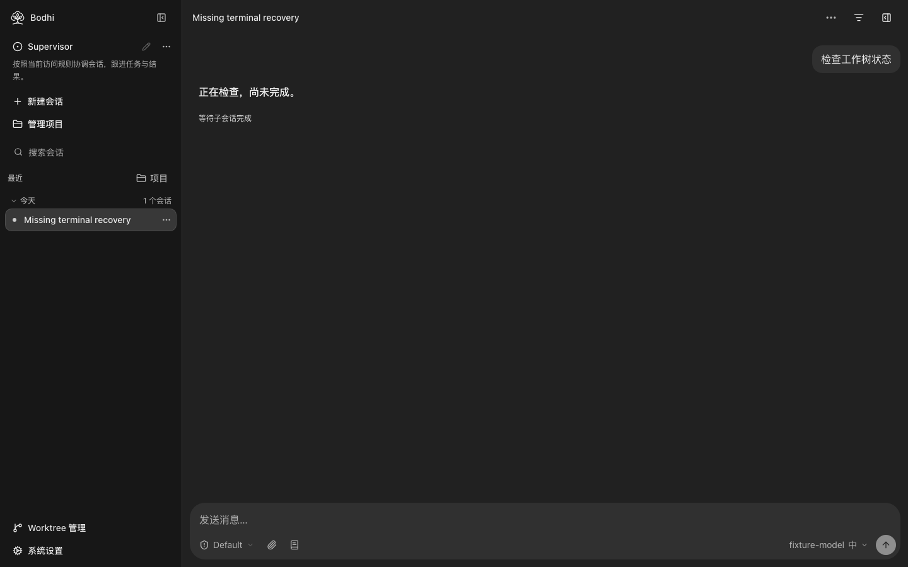
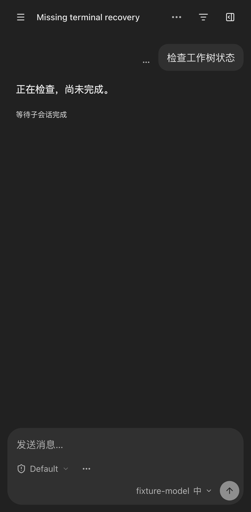

# Supervisor child wait regression

These screenshots come from the controlled `owned-stream-recovery` browser scenario using the Node 24 built frontend at source `7f4867b34951205a5b886f4351eac8f4bfd5289c`. The scenario confirms suspended parent state with an executing child and renders `等待子会话完成` with the ordinary send control available.

The local browser run passed all nine desktop, tablet and phone cases, including suspended reload and completion-triggered resume. The images retain the fixture model label and fixture session title.

The separate live observation connects the development frontend to the original installed Bodhi backend and configured DeepSeek Root/Worker. It is recorded in [Lotus #557](https://github.com/bigduu/lotus-next/issues/557). Formal installed frontend consumption is a later delivery stage.

