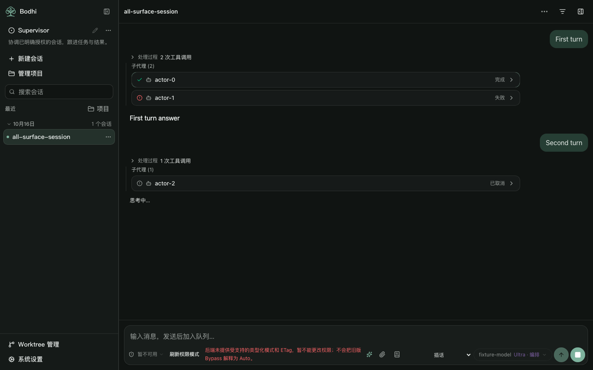
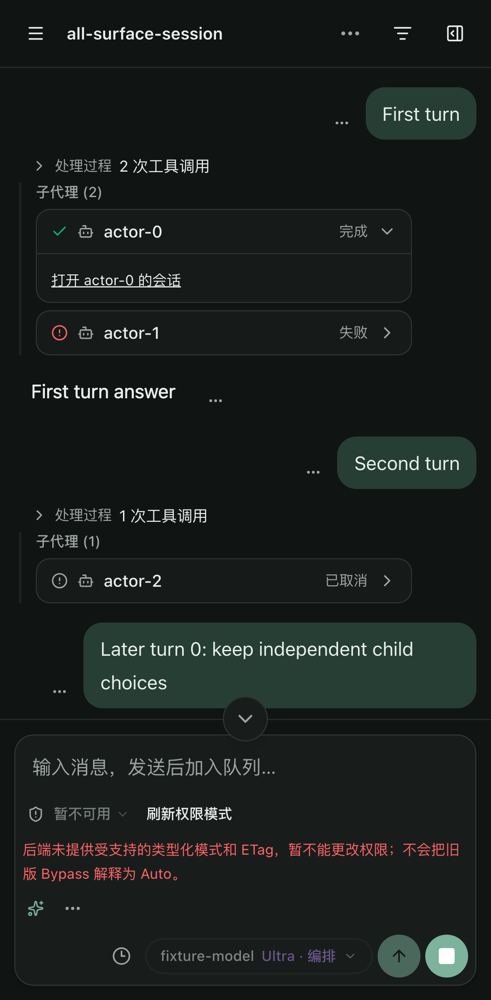
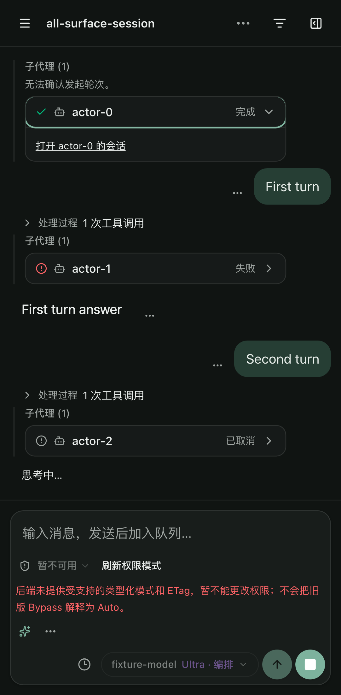

# Collapsible subagent integration acceptance

Local #382 makes each inline child card compact by default. Its header keeps the authoritative lifecycle visible; a native button with `aria-expanded` and `aria-controls` reveals details. Opening the original child conversation is a separate explicit action. Cancellation keeps its own label and neutral detail styling.

The candidate reuses #331's activation readback and verified first-create placement. Expansion choices live in MessageList, keyed by child session ID, above virtual rows and the live/history projection. Streaming, lifecycle changes, later calls, reconnect and row removal do not force expansion or erase a choice. Reload restores the same collapsed default as ordinary tools; canonical state and origin are read again. Missing provenance remains visibly unanchored.

## Source and integration

| Input or checkpoint | Commit |
| --- | --- |
| Preserved #322/#331 candidate | `4d8383fb8876460ac40348f692fe50902b6716bf` |
| Current main, checked again before handoff | `a87c02053b22366a94c57432e9b0253c0d0bbe03` |
| Normal local merge with both histories | `b156e1678dc5cc74d36aac26dbd1f91e9974c62c` |
| Collapse implementation and initial acceptance | `ebb4865970dda86ea0ef511bad52270df752ad1a` |
| Final test corrections and clean product build | `cf1ea35022bbeeee585bb82d1eb1660ab0af25ae` |

Four conflicts were reported before resolution: ChatPane, actorSnapshot and both locales. Main's late portal/cancellation behavior is retained and also called when lazy Work details become ready. The existing main terminal guard is identical to #331's; its lifecycle projection is exported without dropping current placement diagnostics. Both locale additions remain. The merge's new ready-Work test fixture explicitly provides the existing controller fields and settles the lazy import.

All 26 prior Supervisor/subagent documents, receipts and screenshots remain byte-identical to the frozen candidate, including the prior **83 passed / 1 existing skip** receipt. That is historical evidence for its recorded source, not a new result on this candidate. Main's manifests, lockfile and budget policy are unchanged; the copied independent dependency tree has 509 installed package versions matching the current lockfile.

## Validation

Node 24.21.0. Type-check, lint, 2174 matching UI keys, architecture, **14 affected unit files / 544 tests**, build and package checks pass. Unit/product inputs are identical between the tested working tree, collapse commit and final product; later changes only correct the new browser fixture.

The affected built-browser selection contains 60 device cases. The first run on `ebb4865` recorded **54 passed / 3 existing device-condition skips / 3 failures**. Only the three new virtual-row cases failed. Test corrections used real upward input to release the bottom pin, supplied main's existing message projection endpoint, and recorded request events outside the fallback-only observer. No product code changed. The corrected three cases pass on `cf1ea35` across desktop, tablet and phone, including visible original child content and no child-history fetch before the explicit conversation action.

Accepted evidence is therefore **54 unchanged passes + 3 corrected-case passes, with 3 existing skips and no flaky outcomes**. It is split across these recorded sources, not presented as a full 60-case run on the last head. Existing skipped cases are the tablet selected-Actor case and tablet/phone desktop-Workbench restoration cases. Unchanged successful cases were not repeated.

The shared product resource SHA256 is `293ef94c48f309dde186877c2afb50764a23b970ca76c9013b0e315430f0be87`. Startup JS is **1,808,063 raw / 556,314 gzip bytes**; CSS is **108,389 raw / 18,410 gzip bytes**, within unchanged ceilings. Each clean build after the fixture corrections produced the same resource identity.

The browser selection covers keyboard Enter/Space, separate child choices, cancellation/completion, stale events, reconnect, reload/origin stability, virtual unmount/remount, unknown origin, coupled Work opening/drafts/results/decisions, explicit initialization and idempotency, readable 409 recovery, mode/identity refusal, capability/eligibility gating, read-only ready empty, mode switching and existing Workbench restoration. It uses strict local HTTP/WebSocket fixtures, not an installed Host or model. The fixture's unrelated permission-mode/ETag warning stays visible.

## Work v1 and delivery limits

Existing #322 scope/client/hook code and #331 status/origin code are byte-identical to the frozen candidate. Work initialization still requires the positive v1 marker, explicit eligibility and exact current Supervisor/incarnation/revision payload together. It submits once, then reads canonical state; a readable conflict restores the read view. It never enables gates, changes mode, imports history or attaches unrelated sessions. Readable zero Work stays ready, and mutation/dispatch gates remain independent.

No additional backend fields are needed for the existing path. The current five wire availability kinds and eight reason codes remain the contract. Independent Root “unattached” requires its own #1058/#2072 result; `scope_requires_recovery` also covers occupied/recovery failures and must not be interpreted as proof of damaged storage. No new enum or inference from free-text reasons is introduced.

This is a local review candidate. #2072 identifies Bodhi's external `58920d5b` client, which still collapses unavailable state to null; current main retained that same path at this investigation. The candidate corrects that delivery gap locally. No PR, remote push, merge, publication or release occurred, and the completed release was not reopened. Installed-Bodhi acceptance, independent Root create/attach/initial input and cross-session controls remain separate work. The original screenshot's runtime/configuration is still uncaptured; earlier actual HTTP/UI receipts retain their original producer revision.

Machine-readable source/blob identities, case results, screenshots and raw evidence hashes are in [the receipt](evidence/subagent-collapse-integration.json). No backend code, persistent authorization, Rust build, paid model or dispatch was used. No other owner's process was stopped.
