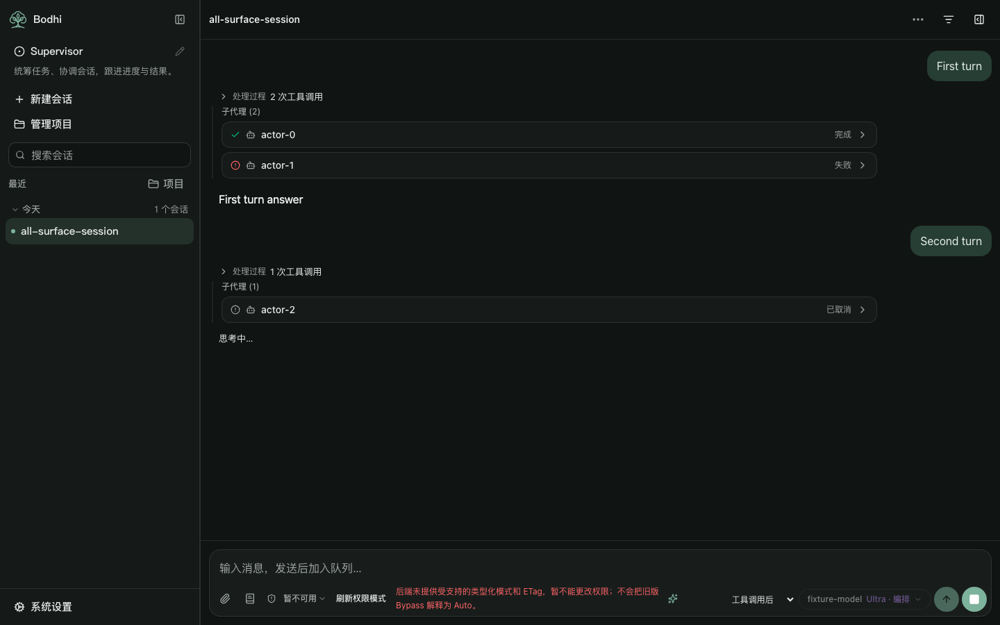
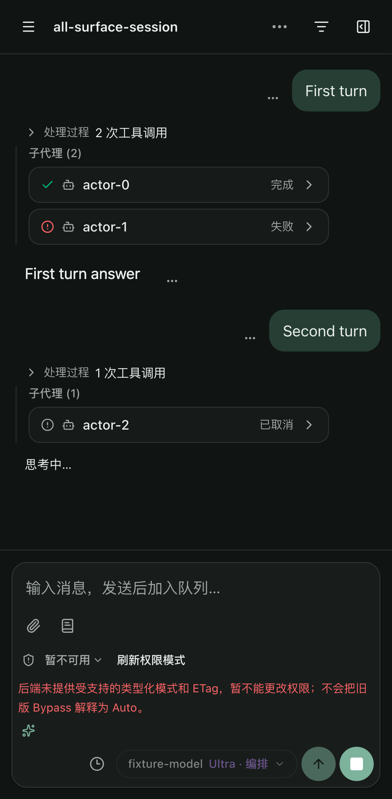

# Inline subagent status and transcript origins

Lotus #331 fixes inline cards that could keep showing Running after a child finished and could move to a later turn when new tool activity arrived. The frontend now reads the current saved activation and places each logical child at its verified creation activity.

Issue: https://github.com/bigduu/lotus-next/issues/331. This is a separate frontend acceptance slice from Supervisor Work #322, grouping persistence #319 and terminology #318. The parent coordination tracker is Bamboo #1968.

## Reproduced frontend causes

At main `5c4f713f2b8624f881c6739ae28d7091f48f796e`:

- `ChatPane.tsx` replaced session-index state with unversioned live child progress. It also mapped every non-running index row to completed, losing failed/cancelled outcomes.
- `SubAgents.tsx` treated cancelled and missing/unrecognized status as Running.
- `MessageList.tsx` attached the entire accumulated child map to the last activity matching `/task|sub.?agent|spawn/`. A later create, wait or unrelated Task activity could move older cards. Its fragment key also depended on that activity's index.

The initial regression run failed the cancelled, unknown and later-turn placement cases. The user's photo shows mixed Running/Done cards but supplies no session/run identities or actual runtime response. It does not establish backend event loss.

## Existing contract and authority

Contract source was checked read-only at accepted Bamboo `bf6b20bab2832b45d4b0927e971cea64866f2c77`:

| Source | Existing evidence used |
| --- | --- |
| `crates/core/bamboo-domain/src/session/actor_snapshot.rs` | Root/subtree identity, per-actor metadata/directory revisions, activation ID/attempt/status; negotiated v2 native task observations |
| `crates/app/bamboo-server/src/handlers/agent/actor_snapshot.rs` | Host-owner authenticated `GET /api/v1/actors/{root}/snapshot?subtree_id={root}`; selectors do not grant visibility |
| `crates/core/bamboo-agent-core/src/agent/events.rs` | Legacy SubAgentStarted/Completed have parent/child IDs and status, without an activation/run ID or originating tool ID |
| `crates/app/bamboo-server-tools/src/sub_agent.rs` | Explicit create result contains `child_session_id` and `reused` |

No backend field or endpoint was added. Ultra is not an identity or permission source. No session attachment, management relationship, persistent authorization or feature gate changes occur.

## Behavior

`useSubAgentView` uses the existing authorized snapshot hook. The inline status reflects its current activation; legacy progress is an invalidation hint only. A delayed completion from activation A cannot complete running activation B. A same-activation terminal snapshot cannot regress to Running. Existing metadata/activation/cursor, reconnect and native-task expiry guards remain active.

Completed, failed, cancelled, queued, idle and retired states have distinct labels. Missing/denied/invalid reads, gaps and unconfirmed native stops display Unconfirmed. Read errors have an explicit Refresh agent status action. Unversioned error/preview text is omitted because it cannot be associated safely with a reused child's current activation.

Inline status and Inspector independently authorize reads while sharing one physical Root tree interest. A view that confirms a higher cursor invalidates older readers before that cursor suppresses covered wire frames. Duplicate in-flight proof requests coalesce. Closing Inspector releases its Actor/content interest; visible inline status keeps its tree interest. No per-child content subscriptions are added by these cards.

`groupSubAgents` matches an explicit `sub_agent` create call to its successful structured result by tool-call ID and child-session ID. The first non-reuse creation fixes the activity key. Waits, status reads, reuses, arbitrary user JSON and broad tool-name matches cannot relocate the child. Unavailable origin evidence is shown separately at a stable location with an explanation. Session recency/status updates do not reorder existing cards; reload uses creation metadata and verified history.

## Validation

Product commits: `91a7b5726aca578450ac7e43b2bfddc12096af02`, `414120673b97d4fb849dd9b5668ef74161ac4cef`, based on the rechecked current main above. Node `24.21.0`.

- `npm run verify`: 152 unit files / 3180 tests passed; type-check, lint, 2074 matching UI locale keys, architecture, build and package checks passed.
- Focused shared-view regressions were red before their fix: another reader received no invalidation, and a duplicate in-flight cursor caused three reads instead of two. The affected convergence suite then passed 248 tests.
- Final browser matrix: 53 passed / 13 existing device-condition skips, with all 9 new subagent cases passing across desktop/tablet/phone. Exact results and resource identity are recorded in `evidence/subagent-status-origin.json`. These use strict HTTP/WebSocket fixtures with the built production frontend, not a live Host/model execution.
- The browser matrix covers terminal states, older unversioned completions, socket reconnect, denied-read retry, stable originating turns and reload; existing Inspector successor/gap/native-task, process activity and projected child-chat regressions also run. The live-to-history handoff and stable React child identity have unit coverage.

Generated fixture screenshots retain the existing permission warning because these fixtures do not advertise typed permission-mode support and an ETag.

## Delivery limits

The branch is local only. No push, PR, merge, app/npm release, Rust build, real model or dispatch execution occurred. The user's installed runtime has not been changed. If the actual Host still reports an active activation after execution finished, that needs runtime evidence and a separate backend diagnosis; this frontend does not invent a terminal outcome.

Older/missing snapshot contracts and history without a matching explicit creation result remain visibly unconfirmed. The frozen #322 candidate and other owners' local fixes are preserved. Combining #331 with #322 is a separate integration step that must refresh overlap resolution, resource budgets and validation.
