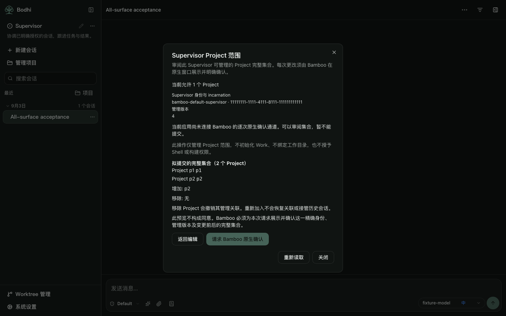
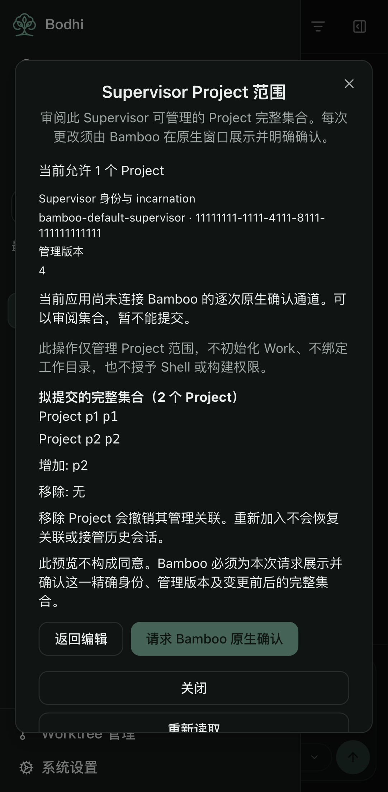

# Bamboo native confirmation profile consumer (#2072)

This local delta removes the old frontend coupling between HTTP owner-verifier availability and native confirmation readiness. A validated canonical scope with HTTP `owner_authorization.available=false` may still request Bamboo's own per-operation native confirmation when the independent native transport/profile is ready. Readiness never means that a change has been approved.

The product remains a local consumer/mock candidate. Its production bridge is still unavailable; no Tauri invocation, IPC loop, real native prompt or scope mutation is connected here.

## Frozen inputs and preserved candidate

| Input | Identity |
| --- | --- |
| Original Project scope UI candidate, preserved unchanged | `9762d30cc21e5034f7046fbdca572b3f1110905c` |
| Original Work/card candidate, preserved unchanged | `8831769170784d85ea23c1ac9f834a48890de19c` |
| New tested product | `69d0c8cb4b87d65f4c885bc252a8d4679de098d1` |
| Independent branch | `lotus-next/feat/2072-native-confirmation-profile-20261019` |
| Native confirmation adapter v1 delta SHA256 | `f81e5c3eec4045d45834d67605afc362991c85ce2d1cfc65bdbe2f97c396e6ce` |

The frozen delta is `2072-native-confirmation-adapter-v1.json` from the original Bamboo owner, under [#2072](https://github.com/bigduu/Bamboo-agent/issues/2072). Its snapshot and hash are retained with the raw evidence. It establishes the additive profile and cancellation semantics; it does not itself prove a producer binary or actual native acceptance. Earlier receipts retain their original source and contract assumptions.

## Local native-port contract

The two method names and full immutable intent stay unchanged. `inspectAvailability(observation)` now returns this normalized **local bridge result**, not an IPC envelope or a new HTTP response:

```ts
{
  transport_ready: boolean,
  authority_profile: null | {
    kind: "bamboo_native_confirmation_v1",
    confirmation_available: boolean,
    confirmation_required_per_request: true,
    unavailable_code: null | NativeConfirmationUnavailableCode
  }
}
```

Only a ready transport plus the exact available per-request profile enables the button that requests Bamboo confirmation. Available profiles require a null unavailable code; unavailable profiles require one of the five frozen refusal codes. Old boolean responses, missing/unknown profiles, non-boolean readiness, contradictory codes and unexpected profile fields remain blocked. The HTTP scope decoder and its truthfully independent verifier flag are unchanged.

`confirmAndApply(exactIntent)` still receives only the canonical Supervisor/incarnation, expected management revision and complete explicitly reviewed Project set. Native binds its owned child/origin/launch/request and asks Bamboo to display the complete before/after intent and confirm once. There is no JavaScript/Bodhi proof, caller-selected destination, HTTP PUT, persistent approval, mode change or security fallback. The UI now names Bamboo as the owner of each native confirmation, and expressly distinguishes readiness from consent.

The native command adapter must normalize these outcomes before passing them through the port:

| Native result | Consumer behavior |
| --- | --- |
| `cancelled` with one of the three frozen codes, `status_code:409`, `not_submitted:true` | Show the specific cancelled/closed/timed-out message, keep the draft, clear review, perform no readback or retry. |
| Partial/unknown cancellation, false or missing guarantee, wrong status, contradictory receipt/extra fields | Treat as unknown and attempt canonical read; never claim the request was not submitted. |
| `refused` 503 with one of the five native confirmation unavailable codes | Normalize to `rejected {status,code}`; show the stable reason, reread only, keep confirmation blocked until an explicit refresh/review. |
| `committed` | Normalize to `applied {receipt}`; show saved only after valid receipt and matching fresh canonical identity/revision/full set. |
| `outcome_unconfirmed`, lost in-flight/reply-pending response | Normalize to `unknown` regardless of a 503 code. Matching canonical state alone never proves this request succeeded. |
| `scope_revision_conflict` | Reread and preserve the explicit draft; clear old review and require a new decision. No replay or automatic prompt. |

The cancellation codes are `native_confirmation_cancelled`, `native_confirmation_window_closed` and `native_confirmation_timed_out`. The unavailable codes cover not enabled, unsupported platform, no GUI, unavailable confirmation thread and general native-confirmation unavailability. These are native-port codes; they are not added to the unchanged HTTP `ScopeErrorCode` or Work v1 schema.

There is no client cancel frame. Closing or editing the review before requesting confirmation makes no apply call. Once a request is pending, the existing dialog guards close/Escape and concurrent requests; lifecycle invalidation discards late acknowledgements. Native remains responsible for request-ID spending, launch/generation checks, helper cancellation and reply-flush guarantees. A lost response cannot be turned into a cancellation from local navigation.

## Verification

Two regressions were reproduced against the original product before the fix: HTTP `available=false` skipped native inspection, and bare `{kind:"cancelled"}` incorrectly asserted no submission. Both are green on the new product. The red run intentionally selected only those two cases; 19 unrelated cases were filtered.

Node 24.21.0. Type-check, lint, **2223 matching UI keys**, architecture, **8 affected unit files / 251 tests**, clean build and package checks pass. Positive HTTP-false/native-profile-ready behavior, malformed/legacy profile rejection, all cancellation/unavailability codes, unknown results, canonical receipt confirmation and stale acknowledgements are exercised with injected JavaScript mocks. Work/card preservation suites are included. The full repository unit suite was not rerun for this focused delta.

The built browser selection passes **33 / 33** across desktop, tablet and phone, with no skips, failures or flaky outcomes. It uses strict HTTP fixtures and the production default-unavailable bridge. It covers both HTTP verifier values, full-set review, scope refresh, failure visibility, keyboard/focus behavior and the existing Supervisor sidebar flows. It confirms no scope write or Ticket/Supervisor bootstrap in scope-view flows. It is not actual native/Bodhi acceptance.

Resource SHA256: `9f8ca5f15a9787690f468077e113da03b91e8deaf95dd70970234f736289612c`. Startup JS is **1,823,738 raw / 560,193 gzip bytes**; CSS is **108,423 raw / 18,413 gzip bytes**, within unchanged budgets. Package verification records 733 files / 18,157,771 unpacked bytes.





## Remaining integration and boundaries

Bodhi's native adapter must expose the normalized profile and outcome metadata before this port can be connected; a legacy boolean result remains blocked. Actual owned-child protocol/startup, Bamboo's same-executable main-thread confirmation provider, and isolated human-approved native acceptance belong to the original native/backend owners and remain **UNRUN here**. No automatic native approval or actual user scope write was performed.

The original `9762d30` and `88317691` worktrees remain frozen. Thirteen retained core/client/manifest files and 39 earlier evidence files are byte-identical, including the original 197-unit/33-browser receipt. Work availability/initialization, Project HTTP schema, role/tool policy, workspace/shell/build rights and management-versus-Work revisions are unchanged. This slice adds no second Ticket initializer or authorization engine.

Only local frontend commits and evidence were created. There was no push, PR, merge, package/App publication, release reopening, backend/Bodhi edit, Rust build, model, dispatch, real grant/security change, historical attach/import or process termination. The exact source/blob, red/green test, browser, artifact and screenshot identities are recorded in [the receipt](evidence/supervisor-native-confirmation-profile.json).
