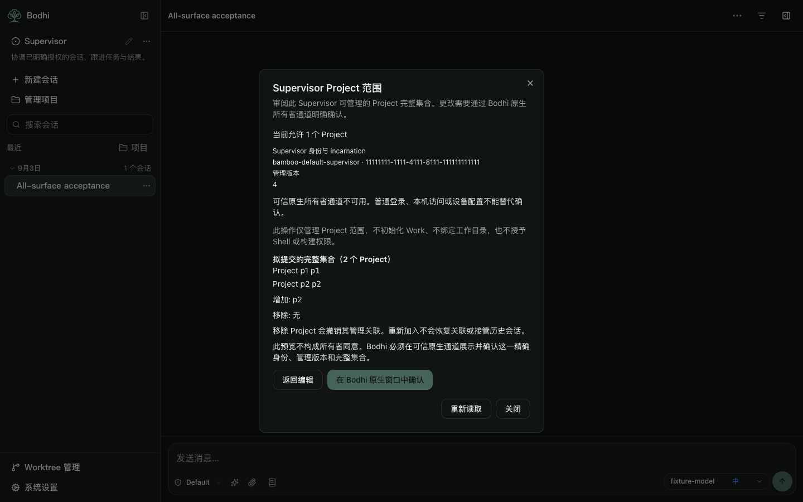
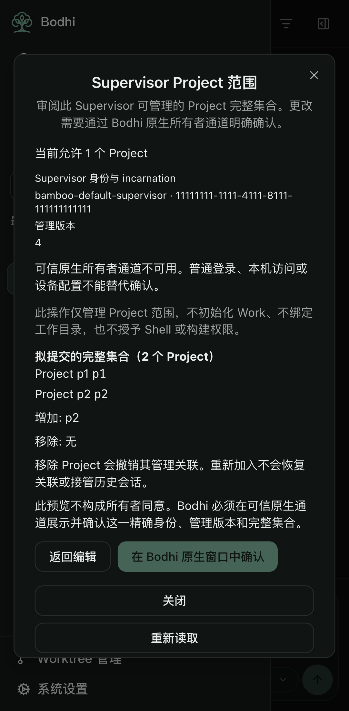

# Supervisor Project scope local preview (#2072)

The Supervisor menu now opens a Project scope dialog that reads the current authority and lets the user review a complete proposed Project set. Production remains read-only: the native bridge defaults to unavailable even when the server advertises an installed verifier. The confirmation state machine is exercised through injected JavaScript mocks. This candidate does not provide a working native authorization channel.

## Frozen inputs and ownership

| Input | Identity |
| --- | --- |
| Preserved Work/card candidate | `8831769170784d85ea23c1ac9f834a48890de19c` |
| Independent branch | `lotus-next/feat/2072-project-scope-ui-mock-20261019` |
| Tested product | `1271832026d08d8c4c927d344ab0956262fd78d5` |
| Bamboo protected merge | `fd374b5a2067110275b955c174e29722835d4a80` |
| Bamboo inspected source head | `7d521cafe83431b072e5125ee1de6203e0a38582` |
| Frozen contract SHA256 | `afb309ba1208fd072d18acc5cd02dc9348d35ddb7d8072745968a91673fd562f` |

This is one local frontend acceptance slice under [Bamboo #2072](https://github.com/bigduu/Bamboo-agent/issues/2072). The original backend and Bodhi owners retain their files and authority boundaries. Their `inspectAvailability()` / `confirmAndApply(exactIntent)` acknowledgement agrees with this local port; it does not freeze a Tauri command, proof or IPC format. The Bodhi design was read from `docs/supervisor-project-scope-host.md` in its owner checkout; the receipt records that local document's hash.

## Local behavior

`services/supervisorScope` makes only the scope GET and the existing Project catalog read. It validates the canonical default Supervisor UUID, a nonnegative safe integer management revision, full unique Project set, positive v1 marker and exact owner-channel semantics. A revision outside JavaScript's exact integer range is refused, not rounded. Empty scope means no Project is currently allowed; it can also result from an explicit removal at a later revision.

The dialog displays identity, incarnation and management revision, retains missing/archived selected IDs, and previews the entire desired set plus additions and removals. It never adds all Projects, silently filters an old selection or edits an authority configuration. Removing a Project revokes links; regrant does not restore or attach them. The preview is not native consent.

The local bridge receives an immutable typed request containing the exact Supervisor reference, expected management revision and `configure_project_scope` full set. Native must eventually own consent, verification, destination binding and at most one submission. JavaScript receives no proof, accepts no owner header or credential fallback and has no scope PUT implementation. A backend verifier marker alone never enables confirmation. Explicit opening is required before a read, and closing/reopening fences late results.

| Outcome in injected mock | Frontend behavior |
| --- | --- |
| No backend verifier or no native bridge | Distinct blocked explanation; full-set preview remains available, confirmation disabled. |
| Cancellation guaranteed before submission | Keep draft, clear review; no write or readback. |
| Known 401/403 refusal | Show refusal reason and withdraw the review; no alternative permission path. |
| 409 conflict | Read canonical state, keep explicit draft, clear consent; require a fresh review and confirmation. |
| 503 unavailable/damaged authority | Preserve the stable reason and block; no repair, mode or feature change. |
| Timeout, disconnected bridge, unfamiliar response or malformed receipt | Outcome unconfirmed; attempt canonical read, never replay. A matching set alone cannot imply this submission succeeded. |
| Readback fails too | Keep outcome unconfirmed and display the read failure; confirmation stays unavailable. |
| Valid acknowledgement | Show saved only after the receipt and fresh canonical identity/revision/full set agree. |

## Validation

Node 24.21.0. Type-check, lint, **2215 matching UI keys**, architecture, **7 affected unit files / 197 tests**, clean build and package checks pass. The unit inputs are identical to the committed product. Browser acceptance on that clean product records **33 passed / 0 skipped / 0 failed / 0 flaky** across desktop, tablet and phone. It includes the new scope menu, keyboard/focus restoration, complete-set preview, backend/native blocked states, canonical refresh, missing Supervisor and invalid authority. A request observer confirms no scope mutation or Supervisor/Ticket initialization in these flows.

The first browser run had 30 passes and three failing test-count assertions: the shared transport retries safe GETs on 503 up to its existing bound. The tests now accept that bound while continuing to reject every write. Raw first-run evidence is retained; the corrected browser selection passed on `2c8c3fa` and again on the final product. Known mock status/code combinations and unknown-result wording were also tightened; the unknown-plus-failed-readback regression is part of the final 197 tests. These are fixture tests, not actual native or installed-Bodhi acceptance. The full repository unit suite was not rerun for this focused slice.

Product resource SHA256: `6f713d1739ed432b9183dff5d7a8fe000cbea455da1a96c8d82e0cb1f213333e`. Startup JS is **1,821,715 raw / 559,701 gzip bytes**; CSS is **108,423 raw / 18,413 gzip bytes**. Package verification finds 733 files / 18,153,716 unpacked bytes, within the existing unchanged budgets.

## Remaining native dependency and delivery limits

Bodhi currently launches the standalone Bamboo entrypoint that constructs `AppState::new`; the normal sidecar cannot install the frozen Rust verifier. The original owners still need to agree an independently verified Host admission source and a trusted startup seam before any production adapter. Private stdin/stdout remains a transport proposal. A successful handshake, ordinary login, local access, device settings or caller-supplied header cannot establish owner consent. No proof or IPC format is frozen by this candidate.

Real native confirmation with the actual candidate server, restart/generation behavior and installed-consumer acceptance remain **UNRUN**. These need the original owners' implementation, an allocated Rust window and disposable fixture data. The current default blocked path must remain until then.

The frozen `88317691` checkout remains clean. Ten retained Work/card/manifests/budget files and 34 prior evidence files are byte-identical; the machine receipt records their blobs. Existing Work v1 availability/initialization and all #322/#331/#382 evidence remain intact. Project management `state_revision` does not replace Work `binding_revision`, initialize Work, bind a workspace or grant shell/build rights. No new Work endpoint or backend field is required by this slice.

Only local commits were created. There was no push, PR, merge, publication, release, installed-app change, backend/native edit, real user grant/security change, historical attach/import, Rust build, model call, dispatch or process termination. Original screenshot runtime/configuration remains uncaptured; older Work HTTP/UI evidence keeps its original producer identity. Machine-readable source, test, screenshot and raw-log identities are in [the receipt](evidence/supervisor-project-scope-preview.json).
