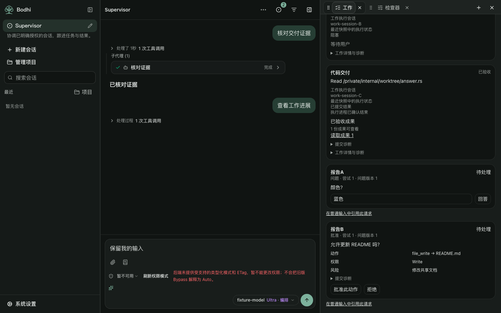
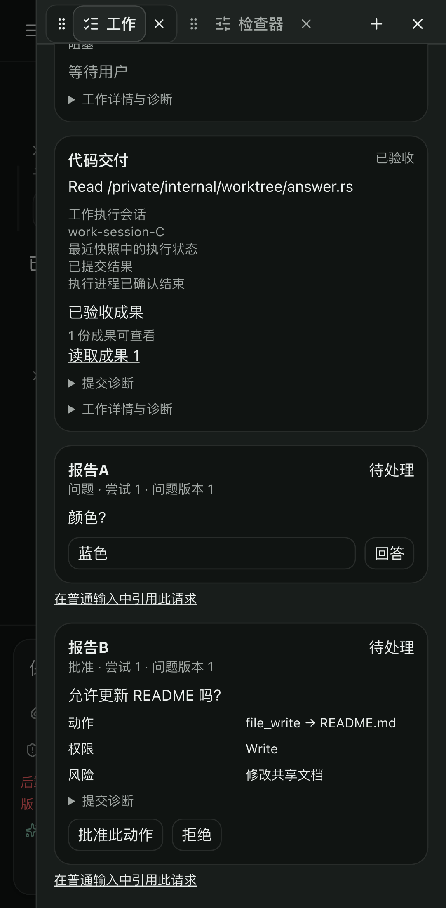

# Supervisor Work and subagent integration acceptance

This local candidate combines frozen #322 `7c928f898f3db09a246e3f611484f81c8821bd3b` and #331 `a4e077f9b5559f5278a244b098cb88a5f144d59b`. Merge `9f88c88e05cdde71d4eb3fd086a368f64489e00c` keeps both commits as parents. Their original branches and historical receipts/screenshots remain unchanged.

The merge automatically reconciled `ChatPane.tsx` and both UI locale files without textual conflicts. The #322 scope/initialization gates and #331 activation readback/origin placement remain separate. No backend API, field, authority, session attachment or feature gate changed.

## Required integration correction

The first combined build failed the existing startup JS ceiling: **1,903,474 > 1,900,000 bytes**. The relevant 13 unit files / 516 tests had already passed.

Commit `85190b5aecf7b71de0eacaab3f843192341bca6e` defers only ready Work details through `LazyTicketWorkPanel`. Scope negotiation, eligibility, initialization and unavailable/error explanations remain eager. The lazy boundary shows loading, keeps load failures local, and offers an explicit loading retry while preserving the conversation. The loaded panel receives the latest controller, including revoked/read-only state.

An existing Work-opening focus intent now waits for cold-loaded details, expires on session navigation, and yields to newer composer focus. Readback or module loading never executes a model, initializes a scope or dispatches Work automatically.

The final product startup JS is **1,893,716 raw / 583,047 gzip bytes**; CSS is **108,993 raw / 18,412 gzip bytes**. Original budgets, manifests, lockfile and ownership rules are unchanged. The packaged `TicketWorkPanel` is a dynamic entry outside the startup closure.

## Validation selected from the actual differences

Node 24.21.0. The separate full-suite receipts from #322 and #331 are retained; unrelated full suites were not repeated.

- Initial conflict-free merge: type-check, lint, 2120 matching UI keys, architecture, and **13 relevant unit files / 516 tests passed**. The failed package-budget log is retained.
- After the deferred-details/focus correction: type-check, lint, 2121 matching keys, and **3 relevant unit files / 175 tests passed**. This includes two new loading/latest-controller/failure-retry tests plus a newer-composer-focus assertion. The remaining unchanged unit inputs retain their initial-merge evidence.
- The architecture check after adding the lazy boundary passed. Final build/package checks passed on the clean product commit. Resource identity: `ec954035d2677fd8ed0bcd8cba63d79ba47e4a36549fbbc8ae9a118f8dd5132b`.
- Built-frontend browser selection: **83 passed / 1 existing tablet-condition skip / 0 flaky** across desktop, tablet and phone: Work availability/initialization/mode changes (69), subagent terminal/origin/reconnect/retry (9), combined Supervisor Workbench (3), and selected-Actor shared-view/navigation (2 passed, 1 skipped).

The combined Workbench fixture gives the same trusted Supervisor a canonical completed child despite a stale Running index, a verified original creation activity before later Task activity, and ready Work execution records. On all three devices it checks terminal/origin stability while opening cold Work details, preserving the conversation/question drafts, reading exact execution sessions and accepted results, submitting an exact approval, and downloading the fixture artifact. Cross-session long-running control remains visibly unavailable under the existing #322 boundary.

The fixture uses existing owner access (`local_bypass`) and strict HTTP/WebSocket responses. It is not a live Host/model execution. Its unrelated typed-permission-mode/ETag warning remains visible in screenshots.

## Evidence and limits

Exact source ancestry, preserved document blob IDs, browser cases, artifact identity, logs/archive hashes and screenshot hashes are in `evidence/supervisor-subagent-integration.json`. That receipt describes this combined candidate; the prior issue receipts retain their original source identities and historical limitations.

Delivery remains local. No push, PR, merge to a remote branch, app/npm publication, Rust build, paid model, live backend call or dispatch occurred. No other owner's process was stopped. The actual runtime/configuration behind the user's photo remains uncaptured; backend event loss is not inferred from it. Newly delivered backend contracts, including cross-session controls, need their own later pairing before the UI can claim them.

The former Bamboo #1971 HTTP fixtures are no longer frontend dependencies:

| Port / PID | Purpose |
| --- | --- |
| 60915 / 39515 | Earlier `42ba238d` empty-scope initialization candidate |
| 61983 / 41843 | `56611128` v1 initialization/idempotency/readable-conflict/old-binding pairing used for the frozen #322 receipt |

Their backend owner may stop them; this task has not sent a termination request or signal.
